<p align="center">
  
</p>

<h1 align="center">SirfBill Restaurant Platform (FastAPI Backend)</h1>

<p align="center">
  <strong>Enterprise Multi-Tenant POS, Kitchen Display System (KDS), Inventory, CRM &amp; Financial Costing Engine</strong>
</p>

<p align="center">
  
  
  
  
  
</p>

---

A high-performance, multi-tenant, enterprise-grade restaurant management backend engineered with **FastAPI**, **SQLAlchemy 2.0**, **PostgreSQL**, and **Pydantic**. Built specifically for **Fine Dine, Cafes, Quick Service Restaurants (QSR), Cloud Kitchens, Bars, and Multi-Branch Restaurant Chains**.

---

## 📂 Repo Layout

```text
.
├── main.py                     # FastAPI application entry point, middleware & router aggregation
├── dependencies.py             # Auth verification, JWT extraction, and database session injection
├── Dockerfile                  # Production container build (Alembic migrations + Uvicorn server)
├── docker-compose.yml          # Multi-container orchestration (PostgreSQL + Backend + pgAdmin)
├── requirements.txt            # Python dependencies
├── alembic.ini                 # Database migration configuration
├── .env                        # Environment configurations (Database, Secrets, Port, Keys)
│
├── alembic/                    # Database migrations
│   ├── env.py                  # Alembic runtime environment
│   └── versions/               # Schema version migration history (Latest: a1c3e5g7i9k1)
│
├── models/                     # SQLAlchemy ORM Models (Tenant-isolated schema)
│   ├── database.py             # Engine, SessionLocal, and Declarative Base
│   ├── user.py                 # Users & Staff with RBAC roles
│   ├── restaurant_outlet.py    # Outlets / Branches under master tenant
│   ├── restaurant_table.py     # Dining tables, sections, and live status
│   ├── restaurant_menu.py      # Categories & Menu items with stations and pricing
│   ├── restaurant_modifier.py  # Menu modifiers and add-on options
│   ├── restaurant_order.py     # Order headers with concurrency versioning
│   ├── restaurant_order_line.py# Order cart line items with prep instructions
│   ├── restaurant_kitchen.py   # Kitchen Order Tickets (KOT) & prep stations
│   ├── restaurant_tender.py    # Payment tenders (Cash, UPI, Card, Khata)
│   ├── restaurant_shift.py     # Cashier shifts, cash drawers, and reconciliation
│   ├── restaurant_ingredient.py# Raw ingredients, categories, and storage zones
│   ├── restaurant_recipe.py    # Bill of Materials (BOM) & ingredient recipes
│   ├── restaurant_stock_ledger.py # Append-only inventory stock ledger
│   ├── restaurant_stock_audit.py  # Physical stock audit batches & count items
│   ├── restaurant_stock_transfer.py# Inter-branch stock transfers
│   ├── restaurant_procurement.py  # Suppliers, Purchase Orders, and Goods Received Notes (GRN)
│   ├── restaurant_customer.py  # CRM guest master, loyalty rules, Khata, and notifications
│   ├── restaurant_subscription.py# Multi-tenant licensing plans & subscription status
│   ├── hardware_product.py     # Buy Hardware catalog & restaurant equipment orders
│   ├── shop_settings.py        # Brand settings, GSTIN, FSSAI, logo, and UPI IDs
│   └── restaurant_audit.py     # POS audit trail (voids, overrides, reprints, refunds)
│
├── routes/                     # REST API Routers
│   ├── auth.py                 # Staff authentication, password verification, and JWT issuance
│   ├── user.py                 # Staff directory and role management (Admin)
│   ├── restaurant_outlets.py   # Multi-branch management endpoints
│   ├── restaurant_tables.py    # Floor plans, seating, and table state machine
│   ├── restaurant_menu.py      # Categories and menu item CRUD
│   ├── restaurant_orders.py    # POS order creation, table binding, cart, and settlement
│   ├── restaurant_kitchen.py   # KOT generation, station routing, and kitchen status
│   ├── restaurant_tenders.py   # Mixed/split payment settlements and thermal receipt generation
│   ├── restaurant_shifts.py    # Cashier drawer open/close and X/Z shift handover
│   ├── restaurant_inventory.py # Inventory items, recipes, stock ledger, and physical count audits
│   ├── restaurant_stock_transfer.py # Inter-branch stock transfers
│   ├── restaurant_procurement.py# Purchase orders and inward GRN processing
│   ├── restaurant_crm.py       # Customer directory, RFM insights, loyalty earn/burn, and Khata
│   ├── restaurant_reports.py   # Sales reports and the 5 Executive Financial Costing reports
│   ├── restaurant_subscriptions.py # Platform licensing, subscription status, and renewals
│   ├── hardware_products.py    # Buy Hardware catalog, equipment ordering, and device specs
│   └── shop_settings.py        # Outlet brand profile, legal details, and bill settings
│
├── schemas/                    # Pydantic Schemas (Request/Response validation)
│   ├── restaurant_order.py     # Order & cart line validation schemas
│   ├── restaurant_menu.py      # Menu & category validation schemas
│   ├── restaurant_table.py     # Dining table validation schemas
│   ├── restaurant_kitchen.py   # KOT ticket schemas
│   ├── restaurant_tender.py    # Payment tender and split settlement schemas
│   ├── restaurant_crm.py       # Customer, loyalty, Khata, and notification schemas
│   ├── restaurant_reports.py   # 5 Executive Reports & Sales response models
│   └── shop_settings.py        # Store settings validation schemas
│
├── utils/                      # External helpers & utilities
│   ├── restaurant_thermal_printer.py # 80mm & 58mm thermal receipt and KOT PDF engine
│   ├── pdf_generator.py        # General report PDF generator
│   └── timezone.py             # UTC & local timezone normalization helpers
│
├── templates/                  # Thermal Receipt HTML & Jinja2 Templates
│   └── thermal_bill_template.html # High-fidelity thermal bill template with UPI QR
│
└── uploads/                    # Persistent storage for uploaded media & receipts
    ├── shop/                   # Restaurant logos and payment QR images
    ├── bills/                  # Generated thermal customer bill PDFs
    └── kots/                   # Kitchen ticket print PDFs
```

---

## 🏛️ High-Level Architecture

### Architectural Components
- **FastAPI Core**: Request dispatching, dependency injection, and automatic OpenAPI documentation.
- **Tenant Isolation**: Every database table is indexed by `tenant_id` (and branch `outlet_id`) ensuring strict tenant isolation across all operations.
- **Concurrency & Locking**: Optimistic version locking on orders (`order.version += 1`) and row-level pessimistic locking (`SELECT ... FOR UPDATE`) on raw ingredient inventory and store credit balances.
- **Append-Only Accounting**: Loyalty points (`RestaurantLoyaltyLedger`), Store Credit Khata (`RestaurantCustomerCreditLedger`), and Stock movements (`RestaurantStockLedger`) are strictly append-only. Balances are never modified in place without an immutable ledger audit trail.

### Request Flow (HTTP)

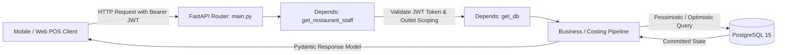

---

## ⚠️ Runtime Constraints & Critical Gotchas

1. **PostgreSQL Environment Variables Are Mandatory**
   - The application relies on `DB_HOST`, `DB_PORT`, `DB_USER`, `DB_PASSWORD`, and `DB_NAME`. Missing variables will cause database initialization to halt.
2. **Optimistic Version Locking on Orders**
   - Every `RestaurantOrder` maintains a `version: int` column. Any concurrent modification from multiple cashier terminals or waiter tablets evaluates `order.version == current_version`. Mismatched versions raise `409 Conflict` to prevent silent overwriting.
3. **Atomic Stock Deduction on Kitchen Dispatch**
   - Recipe ingredients are deducted atomically upon KOT dispatch (`POST /api/restaurant/kitchen/orders/{order_id}/send-kot`) or direct counter settlement. Stock balances use `SELECT ... FOR UPDATE` row locks to prevent race conditions.
4. **Append-Only Financial Ledgers**
   - Never update `loyalty_points`, `credit_balance`, or `current_stock` without writing a corresponding ledger row (`RestaurantLoyaltyLedger`, `RestaurantCustomerCreditLedger`, `RestaurantStockLedger`). Every ledger row requires an `idempotency_key` to avoid duplicate entries during network retries.
5. **Thermal Print Engine & Static Mounts**
   - Generated PDF receipts and KOTs are stored under `uploads/bills/` and `uploads/kots/`. Static files are mounted at `/uploads`.

---

## ⚙️ Environment Variables

### Required (Database)
| Variable | Description | Default |
| :--- | :--- | :--- |
| `DB_HOST` | PostgreSQL Host Address | `localhost` |
| `DB_PORT` | PostgreSQL Port | `5432` |
| `DB_USER` | PostgreSQL Username | `postgres` |
| `DB_PASSWORD` | PostgreSQL Password | *(Required)* |
| `DB_NAME` | PostgreSQL Database Name | `sirfbill_restaurant` |

### Optional (Security & Integrations)
| Variable | Description | Default |
| :--- | :--- | :--- |
| `JWT_SECRET` | Secret key for signing JWT tokens | *(Required in prod)* |
| `ALGORITHM` | JWT signing algorithm | `HS256` |
| `ACCESS_TOKEN_EXPIRE_MINUTES` | Token validity duration | `1440` (24 Hours) |
| `APITXT_AUTH_KEY` | Fast2SMS / SMS Gateway Key | *(Optional)* |
| `RAZORPAY_KEY_ID` | Razorpay Key for License Subscriptions | *(Optional)* |
| `RAZORPAY_KEY_SECRET` | Razorpay Secret for Signature Verification | *(Optional)* |

---

## 🗄️ Database Models & Entity Relationship Diagram (ERD)

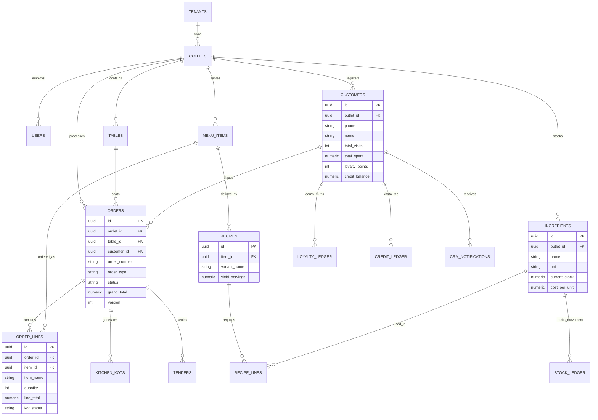

---

## 🏛️ The 6 Core Modules

---

## 1. 🧾 Restaurant POS Module

Handles real-time table billing, counter takeaway sales, delivery orders, tender settlements, and thermal receipt generation.

### 🔄 Order Settlement Sequence Flow
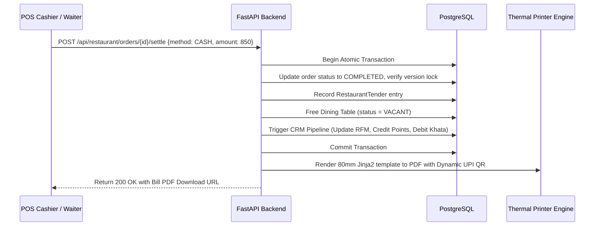

### 🔌 API Endpoints
| Method | Endpoint | Description |
| :--- | :--- | :--- |
| `GET` | `/api/restaurant/orders` | List active & past orders (filters: `outlet_id`, `status`, `order_type`, date range) |
| `POST` | `/api/restaurant/orders` | Create order header (Dine-in, Takeaway, Delivery) |
| `GET` | `/api/restaurant/orders/{order_id}` | Fetch order details, line items, version, and financial breakdown |
| `POST` | `/api/restaurant/orders/{order_id}/lines` | Append items, variants, modifiers, and prep notes to cart |
| `PATCH` | `/api/restaurant/orders/{order_id}/lines/{line_id}` | Update quantity or cancel an order line |
| `POST` | `/api/restaurant/orders/{order_id}/transitions` | Order state transitions (`SENT_TO_KITCHEN`, `READY`, `SERVED`, `CANCELLED`) |
| `POST` | `/api/restaurant/orders/{order_id}/settle` | Settle counter bill, record tender, auto-deduct stock, free table, trigger thermal receipt |
| `POST` | `/api/restaurant/tenders/{order_id}/settle` | Mixed / split tender checkout (Cash + UPI + Card + Khata) in single transaction |
| `GET` | `/api/restaurant/tenders/{order_id}/receipt` | Printable thermal invoice dataset with reprint audit counter |
| `GET` | `/api/restaurant/shifts/current` | Get active cashier shift details |
| `POST` | `/api/restaurant/shifts/open` | Open cashier shift with initial cash float |
| `POST` | `/api/restaurant/shifts/close` | Reconcile and close cashier shift with X/Z report output |

### 📐 Mathematical Formulas

#### A. Pre-Tax Line Item Subtotal
$$\text{Line Subtotal} = (\text{Unit Price} \times \text{Quantity}) + \sum_{m=1}^{k} \text{Modifier Price}_m$$

#### B. Order Discount Computation
- **Percentage Discount:**
  $$\text{Discount Amount} = \text{Order Subtotal} \times \left(\frac{\text{Discount Rate}}{100}\right)$$
- **Fixed / Flat Discount:**
  $$\text{Discount Amount} = \min(\text{Order Subtotal}, \text{Flat Discount Value})$$

#### C. Taxable Base & GST (CGST / SGST / IGST)
$$\text{Taxable Base} = \text{Order Subtotal} - \text{Discount Amount}$$

$$\text{CGST} = \text{Taxable Base} \times \left(\frac{\text{Tax Rate}}{2 \times 100}\right)$$

$$\text{SGST} = \text{Taxable Base} \times \left(\frac{\text{Tax Rate}}{2 \times 100}\right)$$

$$\text{Total Tax} = \text{CGST} + \text{SGST}$$

#### D. Rounding & Grand Total (50-Paisa Banking Round)
$$\text{Raw Total} = \text{Taxable Base} + \text{Total Tax}$$

$$\text{Grand Total} = \text{round}(\text{Raw Total}, 0)$$

$$\text{Rounding Adjustment} = \text{Grand Total} - \text{Raw Total}$$

#### E. Cashier Drawer Reconciliation (Shift Closing)
$$\text{Expected Cash} = \text{Opening Cash Float} + \sum \text{Cash Tender Receipts} - \sum \text{Cash Payouts}$$

$$\text{Cash Variance} = \text{Actual Counted Cash} - \text{Expected Cash}$$

---

## 2. 🍳 Kitchen Display System (KDS) & KOT Module

Manages Kitchen Order Tickets (KOTs), prep station line item routing, and kitchen cooking transitions.

### 🗄️ Kitchen Data Models & Relationship Diagram

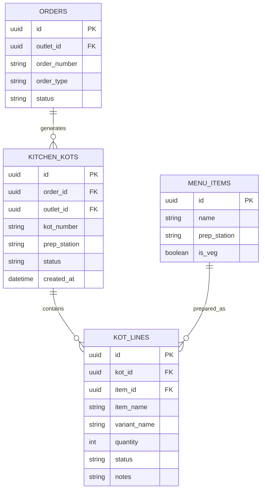

#### KOT Station Routing & Preparation Flow
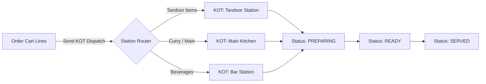

### 🔌 API Endpoints
| Method | Endpoint | Description |
| :--- | :--- | :--- |
| `GET` | `/api/restaurant/kitchen/kots` | Real-time active KOT tickets filtered by outlet, station, or status |
| `POST` | `/api/restaurant/kitchen/orders/{order_id}/send-kot` | Generate numerical `KOT-XXXXXX`, route items to stations, print thermal KOT |
| `PATCH` | `/api/restaurant/kitchen/kots/{kot_id}/items/{item_id}/status` | Item-level state transition (`PREPARING` → `READY` → `SERVED`) |
| `POST` | `/api/restaurant/kitchen/kots/{kot_id}/complete` | Mark complete KOT batch ready for runner dispatch |
| `POST` | `/api/restaurant/kitchen/kots/{kot_id}/reprint` | Reprint physical KOT slip with reprint audit flag |
| `GET` | `/api/restaurant/kitchen/stations` | List configured prep stations (*Main Kitchen, Tandoor, Bar, Pantry, Desserts*) |

### 📐 Mathematical & Routing Logic
- **KOT Ticket Sequence:**
  ```text
  KOT Code = "KOT-" + Date(YYYYMMDD) + "-" + PadZero(Daily_Sequence, 4)
  Example: KOT-20261120-0001
  ```
- **Station Split Routing Logic:**
  ```text
  KOT(Station) = { order_line in Order | order_line.item.prep_station == Station }
  ```

---

## 3. 📦 Restaurant Inventory, Recipes & Procurement Module

Tracks raw materials, Unit of Measure (UOM) conversions, recipes (Bill of Materials), Moving Weighted Average Cost (WAC), physical count audits, and inter-branch transfers.

### 🗄️ Inventory, Recipe BOM & Procurement Relationship Diagram

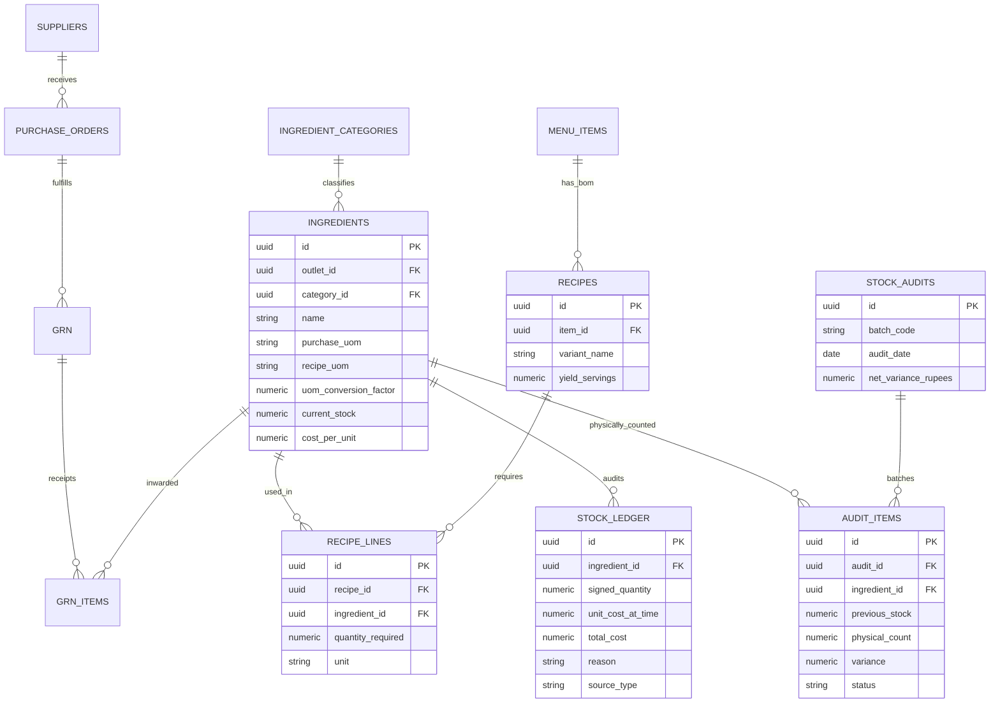

#### Inward Procurement & BOM Consumption Pipeline
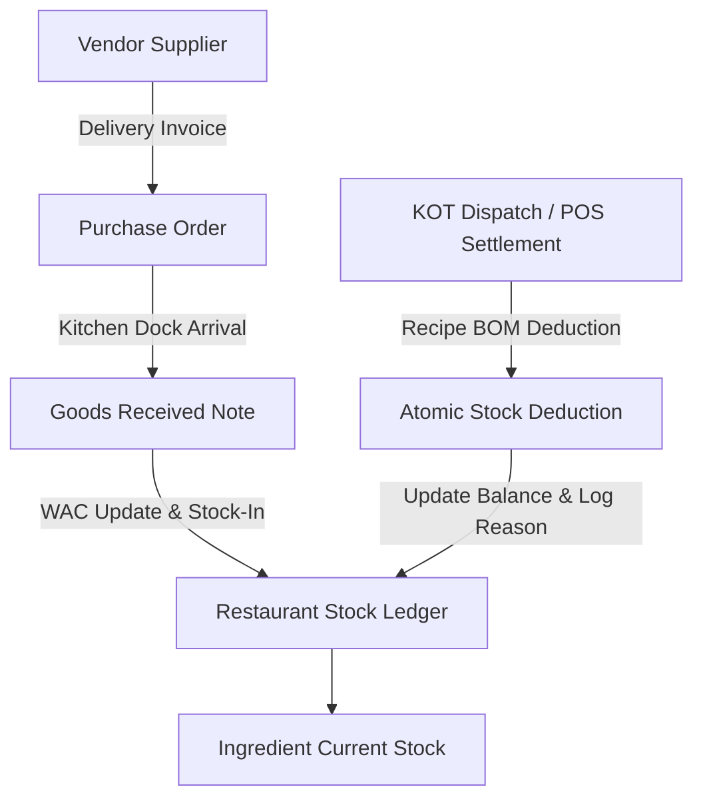

### 🔌 API Endpoints
| Method | Endpoint | Description |
| :--- | :--- | :--- |
| `GET`, `POST` | `/api/restaurant/inventory/categories` | Ingredient storage categories and temperature zones (Walk-in chiller, Ambient, etc.) |
| `GET`, `POST`, `PATCH` | `/api/restaurant/inventory/ingredients` | Ingredient master with UOM, par levels, and Moving Average Cost |
| `GET` | `/api/restaurant/inventory/stock-summary` | Real-time stock levels, valuation, and reorder alerts |
| `GET`, `POST`, `PATCH` | `/api/restaurant/inventory/recipes` | Recipe (BOM) mapping: menu item to raw ingredients |
| `GET` | `/api/restaurant/inventory/ledger` | Append-only inventory transaction ledger |
| `POST` | `/api/restaurant/inventory/audits/start` | Initialize physical inventory stock audit batch |
| `POST` | `/api/restaurant/inventory/audits/{id}/items` | Enter physical count (recipe UOM or purchase UOM) |
| `POST` | `/api/restaurant/inventory/audits/{id}/commit` | Post audit variances to ledger, adjusting book balances |
| `POST` | `/api/restaurant/inventory/wastage/log` | Record raw material spoilage / kitchen wastage with financial loss snapshot |
| `POST` | `/api/restaurant/stock-transfers` | Transfer ingredients between outlets (Source Dispatch → Destination Receipt) |
| `POST` | `/api/restaurant/procurement/grn` | Inward Goods Received Note (GRN) from vendor invoices |

### 📐 Mathematical Formulas

#### A. UOM Normalization
$$\text{Normalized Qty} = \text{Input Quantity} \times \text{UOM Conversion Factor}$$

*(e.g., $2.5\text{ KG Chicken} \times 1000 = 2500\text{ G}$)*

#### B. Moving Weighted Average Cost (WAC / MAC)
When new stock enters via inward GRN:
$$\text{New WAC} = \frac{(\text{Current Qty} \times \text{Old WAC}) + (\text{GRN Qty} \times \text{GRN Purchase Price})}{\text{Current Qty} + \text{GRN Qty}}$$

#### C. Recipe Bill of Materials (BOM) Plate Cost
$$\text{Plate Cost} = \sum_{i=1}^{n} \left(\frac{\text{Quantity Required}_i}{\text{Yield Servings}} \times \text{WAC Unit Cost}_i\right)$$

#### D. Physical Stock Audit Variance
$$\text{Variance Qty} = \text{Physical Count} - \text{Expected Book Stock}$$

$$\text{Rupee Variance Impact} = \text{Variance Qty} \times \text{WAC Unit Cost}$$

- **Surplus:** $\text{Variance Qty} > 0$
- **Deficit (Shrinkage):** $\text{Variance Qty} < 0$

---

## 4. 👥 CRM, Loyalty & Executive Reports Module

Unified multi-branch guest wallet, append-only loyalty points ledger, store credit (Khata), automated marketing notifications, and 5 executive financial costing reports.

### 🗄️ CRM, Loyalty & Khata Relationship Diagram

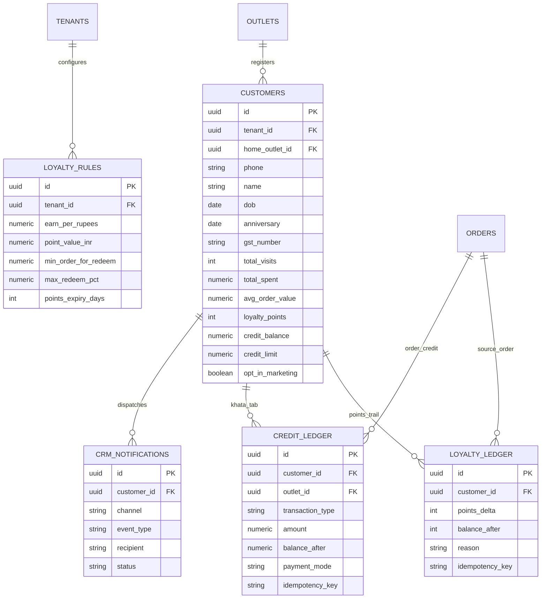

#### Guest Settlement & Loyalty Earning Pipeline
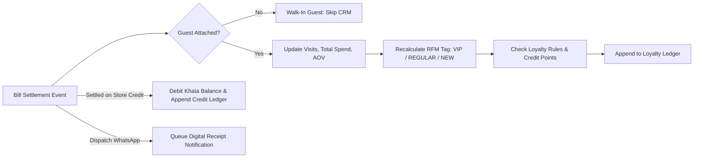

### 🔌 API Endpoints (CRM & Loyalty)
| Method | Endpoint | Description |
| :--- | :--- | :--- |
| `GET` | `/api/restaurant/crm/customers` | Search guests by phone/name, filter by RFM segment (`ALL`, `VIP`, `REGULAR`, `NEW`, `AT_RISK`) |
| `POST` | `/api/restaurant/crm/customers` | Register or update guest profile with dietary preferences, special dates, and GSTIN |
| `GET`, `PATCH` | `/api/restaurant/crm/customers/{id}` | Read or modify customer profile and credit limit |
| `GET` | `/api/restaurant/crm/customers/{id}/insights` | 360° guest insights: RFM metrics, Top 5 dishes, recent bills |
| `GET`, `POST` | `/api/restaurant/crm/loyalty-rules` | Fetch or configure brand loyalty earn/burn rules |
| `POST` | `/api/restaurant/crm/customers/{id}/loyalty/adjust` | Idempotent points earn/burn with balance verification |
| `GET` | `/api/restaurant/crm/customers/{id}/loyalty/history` | Immutable loyalty transaction ledger audit trail |
| `GET` | `/api/restaurant/crm/customers/{id}/khata` | Khata credit balance and detailed ledger statement |
| `POST` | `/api/restaurant/crm/customers/{id}/khata/settle` | Settle outstanding credit dues with partial/full payment |
| `POST` | `/api/restaurant/crm/customers/{id}/notify` | Dispatch WhatsApp / SMS / Email receipt or promo message |
| `POST` | `/api/restaurant/crm/scheduled/run-automations` | Daily cron: birthday rewards, anniversary offers, 30-day win-back alerts |

### 🔌 API Endpoints (The 5 Executive Reports)
| Method | Endpoint | Description |
| :--- | :--- | :--- |
| `GET` | `/api/restaurant/reports/food-cost-variance` | **Executive Report 1:** Theoretical COGS vs. Actual COGS, isolating Wastage and Audit Shrinkage |
| `GET` | `/api/restaurant/reports/stock-movement` | **Executive Report 2:** Stock Movement: Opening + Inward - Consumed - Wastage $\pm$ Audit = Closing |
| `GET` | `/api/restaurant/reports/menu-engineering` | **Executive Report 3:** BCG Matrix: STAR, PLOWHORSE, PUZZLE, DOG, plate cost, margin, cost alerts |
| `GET` | `/api/restaurant/reports/procurement` | **Executive Report 4:** Vendor spend, GST input tax by slab (5%, 12%, 18%), unpaid GRN aging buckets |
| `GET` | `/api/restaurant/reports/shrinkage` | **Executive Report 5:** Top 20 cost-leaking ingredients across Spoilage, Burnt, Return, and Deficit |

### 📐 Mathematical Formulas

#### A. Recency, Frequency, Monetary (RFM) Metrics
$$\text{Average Order Value (AOV)} = \frac{\text{Total Spend}}{\text{Total Visits}}$$

**Segmentation Thresholds:**
- **VIP:** Total Lifetime Spend $\ge ₹5,000$ or Total Visits $\ge 10$
- **REGULAR:** Total Visits $\ge 3$
- **NEW:** Total Visits $< 3$
- **AT_RISK:** Inactive for $> 30$ days since last dining visit

#### B. Loyalty Points Accrual & Redemption
$$\text{Points Earned} = \left\lfloor\frac{\text{Order Grand Total}}{\text{Earn Per Rupees}}\right\rfloor$$

$$\text{Max Allowed Burn (₹)} = \text{Order Grand Total} \times \left(\frac{\text{Max Redeem Pct}}{100}\right)$$

#### C. Theoretical vs. Actual COGS (Food Cost Variance)
$$\text{Theoretical COGS} = \sum (\text{KOT Deducted Recipe Qty} \times \text{WAC at Time})$$

$$\text{Actual COGS} = \text{Theoretical COGS} + \text{Logged Wastage Loss} + \text{Physical Audit Deficit}$$

$$\text{Unexplained Variance} = \text{Actual COGS} - \text{Theoretical COGS}$$

$$\text{Variance Pct of Sales} = \left(\frac{\text{Unexplained Variance}}{\text{Total Food Sales}}\right) \times 100$$

#### D. Menu Engineering BCG Matrix Classification
For every menu item $j$:
$$\text{Gross Margin}_j = \text{Selling Price}_j - \text{Plate Cost}_j$$

$$\text{Food Cost Pct}_j = \left(\frac{\text{Plate Cost}_j}{\text{Selling Price}_j}\right) \times 100 \quad (\text{Alert if } > 35\%)$$

Thresholds:
$$\overline{\text{Margin}} = \frac{\sum \text{Total Margin}}{\sum \text{Total Qty Sold}}, \quad \overline{\text{Popularity}} = \frac{\sum \text{Total Qty Sold}}{\text{Number of Unique Menu Items}}$$

| Quadrant | Volume Condition | Margin Condition | Menu Action Strategy |
| :--- | :--- | :--- | :--- |
| ⭐ **STAR** | $\text{Qty} \ge \overline{\text{Popularity}}$ | $\text{Margin} \ge \overline{\text{Margin}}$ | Maintain high quality; prime menu placement |
| 🐴 **PLOWHORSE** | $\text{Qty} \ge \overline{\text{Popularity}}$ | $\text{Margin} < \overline{\text{Margin}}$ | Repackage, adjust portions, or re-engineer cost |
| 🧩 **PUZZLE** | $\text{Qty} < \overline{\text{Popularity}}$ | $\text{Margin} \ge \overline{\text{Margin}}$ | Upsell, feature on specials board, run promotions |
| 🐕 **DOG** | $\text{Qty} < \overline{\text{Popularity}}$ | $\text{Margin} < \overline{\text{Margin}}$ | Re-engineer recipe or consider eliminating |

#### E. Stock Movement Balance Equation
$$\text{Closing Stock} = \text{Opening} + \text{GRN In} + \text{Net Transfers} - \text{KOT Sold} - \text{Wastage} + \text{Audit Adjust}$$

$$\text{Closing Valuation} = \text{Closing Stock} \times \text{Cost per Unit}$$

---

## 5. 🧑‍🍳 Captain & Waiter Module

Table-side ordering for captains, real-time floor plan visualization, seating assignments, and table transfers.

### 🗄️ Floor Plan, Table Seating & Ordering Relationship Diagram

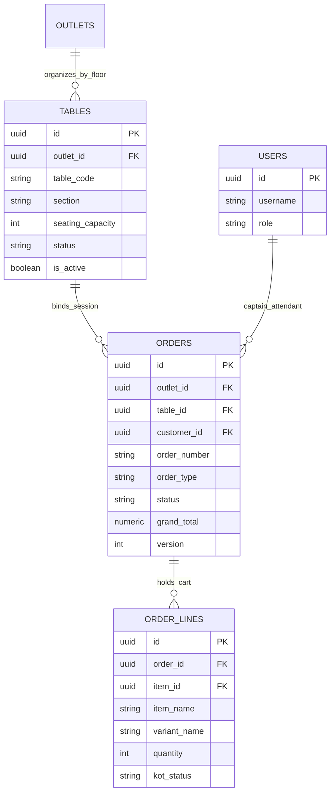

#### Table Lifecycle State Machine
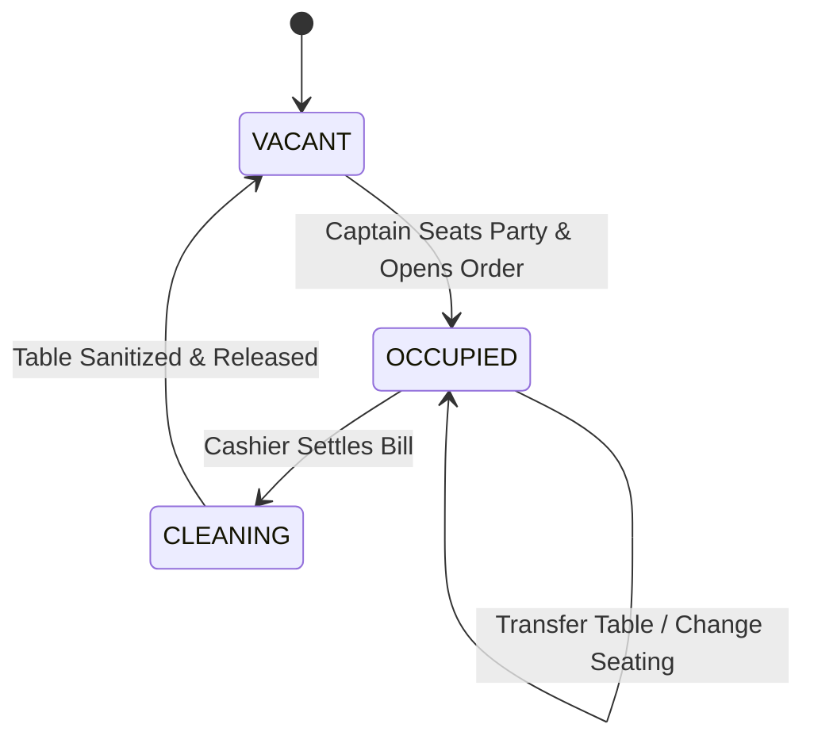

### 🔌 API Endpoints
| Method | Endpoint | Description |
| :--- | :--- | :--- |
| `GET` | `/api/restaurant/tables` | Live table matrix across floors/sections (`VACANT`, `OCCUPIED`, `RESERVED`, `CLEANING`) |
| `POST` | `/api/restaurant/tables/{table_id}/seat` | Seat guests, attach party size, bind assigned waiter/captain |
| `POST` | `/api/restaurant/orders` | Captain creates table-bound Dine-in order |
| `POST` | `/api/restaurant/orders/{order_id}/lines` | Add running items or extra rounds to active table |
| `POST` | `/api/restaurant/kitchen/orders/{order_id}/send-kot` | Direct send-to-kitchen from mobile table ordering tablet |
| `POST` | `/api/restaurant/orders/{order_id}/transitions?payload=SERVED` | Mark food served to guests |
| `POST` | `/api/restaurant/tables/{table_id}/transfer` | Transfer or merge party from Table A to Table B |

### 📐 Mathematical Metrics
- **Table Turnover Rate:**
  $$\text{Table Turnover} = \frac{\text{Total Dine-in Orders on Table}}{\text{Operational Shift Hours}}$$
- **Dining Duration:**
  $$\text{Dining Time} = \text{Settlement Time} - \text{Seated Time}$$

---

## 6. 🛡️ Admin, Multi-Tenant & Subscription Module

Role-based access control, tenant branch management, legal configuration, dynamic UPI QR generation, and platform billing.

### 🗄️ Multi-Tenant, RBAC & Subscription Relationship Diagram

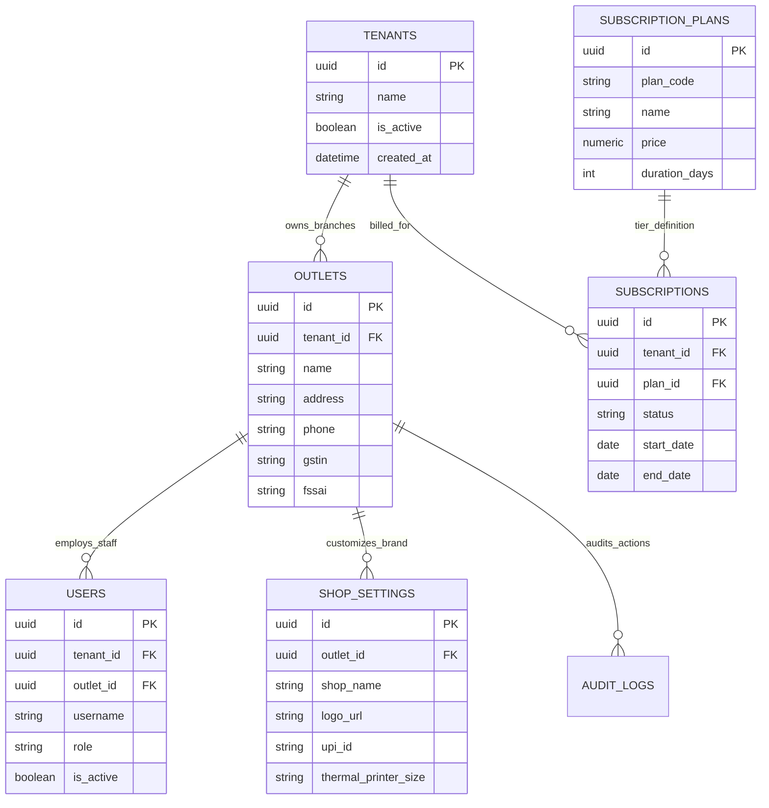

#### Multi-Tenant RBAC Hierarchy
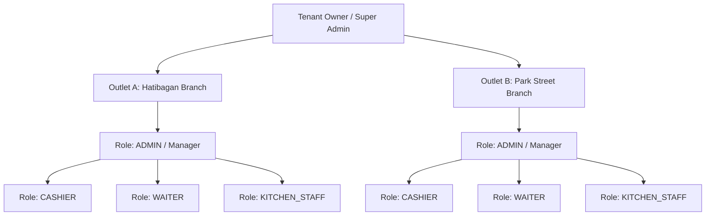

#### 🛡️ Role-Based Access Control (RBAC) Permission Matrix

| Capability / API Scope | Super Admin | Outlet Manager (`ADMIN`) | Cashier (`CASHIER`) | Captain / Waiter (`WAITER`) | Kitchen Chef (`KITCHEN_STAFF`) |
| :--- | :---: | :---: | :---: | :---: | :---: |
| **Dine-in Floor & Seating** | Full | Full | Full | View & Seat | Read Only |
| **Create & Append Orders** | Full | Full | Full | Full | No Access |
| **Void / Discount Override** | Full | Full | Requires Approval | No Access | No Access |
| **Bill Settlement & Tender** | Full | Full | Full | No Access | No Access |
| **KOT Kitchen Dispatch** | Full | Full | Full | Full | No Access |
| **KOT Cooking Status (KDS)** | Full | Full | Read Only | Read Only | Full (`PREPARING`, `READY`) |
| **Inventory & GRN Inward** | Full | Full | No Access | No Access | Read Only |
| **Physical Stock Audits** | Full | Full | No Access | No Access | Count Entry Only |
| **CRM Directory & Khata** | Full | Full | Full (Lookup & Settle) | Lookup Only | No Access |
| **The 5 Executive Reports** | Full | Full | Daily Shift Only | No Access | No Access |
| **Store Branding & UPI** | Full | Full | No Access | No Access | No Access |
| **Staff Directory & Roles** | Full | Full | No Access | No Access | No Access |

### 🔌 API Endpoints
| Method | Endpoint | Description |
| :--- | :--- | :--- |
| `POST` | `/api/auth/token` | Staff login, password verification, and JWT access token issuance |
| `POST` | `/api/auth/admin-login` | Administrative dashboard authentication |
| `GET`, `POST` | `/api/admin/users` | Staff directory: create & manage Cashiers, Waiters, and Kitchen staff |
| `GET`, `POST`, `PATCH`| `/api/restaurant/outlets` | Multi-branch management under master tenant |
| `GET`, `PATCH` | `/api/shop-settings/{outlet_id}`| Brand details: GSTIN, FSSAI, logo URL, UPI ID, and thermal bill layout |
| `GET` | `/api/subscriptions/plans` | Platform subscription tiers (Silver, Gold, Platinum) |
| `GET` | `/api/subscriptions/status` | Current tenant subscription validity, active plan, days remaining |
| `POST` | `/api/subscriptions/create-order`| Initiate Razorpay order for platform license renewal |
| `POST` | `/api/subscriptions/verify-payment`| Verify payment signature and extend tenant subscription dates |
| `GET` | `/api/subscriptions/history` | Billing invoices and platform license payment history |

### 📐 Mathematical & Technical Logic

#### A. Dynamic Bharat UPI QR Code Spec
Embedded in customer thermal receipts for immediate cashierless UPI scanning:
```text
upi://pay?pa={UPI_ID}&pn={URL_ENCODED_SHOP_NAME}&am={GRAND_TOTAL}&cu=INR&tn={ORDER_NUMBER}
```

#### B. Subscription Expiry & Grace Window
$$\text{Days Remaining} = \text{End Date} - \text{Current Date}$$

- **ACTIVE:** $\text{Days Remaining} > 0$
- **GRACE-PERIOD:** $-3 \le \text{Days Remaining} \le 0$
- **EXPIRED:** $\text{Days Remaining} < -3$

---

## 7. 🛒 Buy Hardware & POS Equipment Marketplace Module

Enables restaurant owners to browse certified hardware devices (thermal receipt printers, all-in-one touch POS terminals, captain handheld PDAs, electronic cash drawers, barcode/QR scanners, KDS screens, and thermal paper rolls) with complete technical specifications, transparent pricing, GST billing, and one-click purchase ordering / demo inquiries directly from their portal.

### 🗄️ Hardware Marketplace Data Models & Relationship Diagram

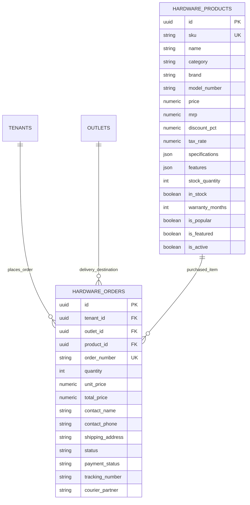

#### Hardware Purchase & Fulfillment Pipeline
```mermaid
flowchart LR
  Browse[Restaurant Dashboard: Buy Hardware] --> Select[Select Product & View Specs]
  Select --> Order[Place Purchase Order / Demo Inquiry]
  Order --> AutoSeq[Generate HWO-YYYYMM-XXXX]
  AutoSeq --> StatusNew[Status: NEW / Order Received]
  StatusNew --> Dispatch[Admin: Invoiced & Shipped via Blue Dart]
  Dispatch --> Tracking[Tracking Number Shared with Restaurant]
  Tracking --> Delivered[Status: DELIVERED]
```

### 🏷️ Hardware Catalog Categories
| Category Code | Category Title | Typical Devices / Consumables |
| :--- | :--- | :--- |
| `PRINTER` | Thermal Receipt & KOT Printers | 80mm USB+LAN+BT auto-cutter printers, 58mm Bluetooth mobile printers |
| `POS_TERMINAL` | All-in-One Touch POS Terminals | 15.6" Dual-screen Intel J4125 touch computers with customer-facing screens |
| `HANDHELD_PDA` | Captain Handheld Ordering Tablets | Android 12 wireless tablets with integrated 58mm printer for table-side KOT |
| `KDS_DISPLAY` | Kitchen Display System Screens | 21.5" Steam & grease-resistant full HD screens for kitchen cooking status |
| `CASH_DRAWER` | Electronic Cash Drawers | Heavy-duty steel drawers with 5 notes / 8 coins compartments & RJ11 trigger |
| `SCANNER` | 1D / 2D Barcode & QR Scanners | Wireless 2.4GHz + Bluetooth barcode scanners with induction charging cradles |
| `PAPER_ROLLS` | Thermal Paper Rolls & Consumables | Premium 80mm x 50m and 58mm BPA-free high-density paper cartons (Box of 50) |
| `ACCESSORY` | Hardware Accessories & Cables | RJ11 cash drawer cables, USB extension hubs, VESA KDS wall mounts |

### 🔌 API Endpoints
| Method | Endpoint | Description |
| :--- | :--- | :--- |
| `GET` | `/api/hardware/categories` | List hardware categories with product counts and UI icons |
| `GET` | `/api/hardware/products` | Browse hardware catalog (filters: `category`, `search`, `in_stock_only`, `popular_only`) |
| `GET` | `/api/hardware/products/{product_id}` | Fetch full hardware specs, bullet points, high-res images, and warranty terms |
| `POST` | `/api/hardware/products` | Add a new hardware product listing with specifications and stock (Admin) |
| `PATCH` | `/api/hardware/products/{product_id}` | Update product pricing, discount, stock quantity, or gallery images (Admin) |
| `DELETE`| `/api/hardware/products/{product_id}` | Soft-deactivate a hardware product listing |
| `POST` | `/api/hardware/orders` | Place a hardware purchase order / request demo inquiry |
| `GET` | `/api/hardware/orders` | List hardware orders placed by current restaurant tenant |
| `GET` | `/api/hardware/orders/{order_id}` | Check hardware order dispatch status, courier partner, and tracking number |
| `PATCH` | `/api/hardware/orders/{order_id}` | Update order status (`CONFIRMED`, `SHIPPED`, `DELIVERED`) and courier tracking (Admin) |
| `POST` | `/api/hardware/seed` | Auto-seed curated restaurant hardware catalog if empty |

---

## 🖨️ Thermal Receipt Printing Specification (80mm & 58mm)

The print engine produces pixel-accurate PDF outputs designed for ESC/POS direct printing:

```text
+--------------------------------------------------------+
|                      [RESTAURANT LOGO]                 |
|            KARIM'S - ORIGINAL FROM JAMA MASJID          |
|    84, Aurobindo Sarani, Hatibagan, Kolkata - 700005   |
|                 GSTIN: 29AAACH7409R1ZX                 |
|                 FSSAI: 21521175000745                  |
+--------------------------------------------------------+
| Bill No: ORD-20261120-0003                 Table: T2   |
| Type: DINE-IN             Date: 12:38 PM - 20/11/2026  |
| Customer: Walk-In Guest                                |
+--------------------------------------------------------+
| ITEM                    QTY         RATE         TOTAL |
| Chicken Tikka Biryani     1       360.00        360.00 |
| Mutton Handi Biryani      1       450.00        450.00 |
+--------------------------------------------------------+
| Total Qty: 2                                           |
| Subtotal:                              Rs.      810.00 |
| CGST (2.5%):                           Rs.       20.25 |
| SGST (2.5%):                           Rs.       20.25 |
| RoundOff:                              Rs.       -0.50 |
|--------------------------------------------------------|
| TOTAL INVOICE BILL:                    Rs.      850.00 |
| PAID AMOUNT:                           Rs.      850.00 |
+--------------------------------------------------------+
|                 [DYNAMIC BHARAT UPI QR]                |
|               Scan to Pay via Any UPI App              |
|                                                        |
|               THANK YOU FOR DINING WITH US!            |
|                     Please visit again                 |
|                          SirfBill                      |
|             Powered by Naiyo24 Pvt. Ltd.               |
+--------------------------------------------------------+
```

---

## 🔒 Concurrency Control & Database Integrity

1. **Optimistic Version Locking:**
   - Every `RestaurantOrder` maintains a `version: int` column.
   - When amending or settling orders, concurrent writes from multiple cashier stations or waiter tablets are evaluated against `order.version == current_version`. Mismatched versions raise HTTP `409 Conflict` to prevent overwriting.
2. **Row-Level Transaction Locking:**
   - Ingredient deduction on KOT dispatch and Khata settlements use `SELECT ... FOR UPDATE` to ensure stock quantities and store credit balances never drift under heavy concurrency.
3. **Idempotency Enforcement:**
   - Financial transactions (`RestaurantTender`, `RestaurantCustomerCreditLedger`, `RestaurantLoyaltyLedger`) enforce unique `idempotency_key` constraints to eliminate duplicate billing on network re-transmissions.

---

## 📡 Key API Request & Response Payloads (JSON Specifications)

### 1. Create Dine-in Order & Append Cart Items
`POST /api/restaurant/orders`
```json
{
  "outlet_id": "00a2b6d2-2803-4384-817a-d8bbaa7a0f28",
  "table_id": "7c9e6679-7425-40de-944b-e07fc1f90ae7",
  "order_type": "DINE_IN",
  "customer_id": "3b4f5cf2-4584-40d5-a9b5-6e58caec65cb",
  "notes": "Less spicy, extra napkins"
}
```

`POST /api/restaurant/orders/{order_id}/lines`
```json
{
  "item_id": "e8a946b2-6712-421f-8e3b-f7253b26c714",
  "variant_name": "Full",
  "quantity": 2,
  "unit_price": 360.00,
  "modifiers": [
    {
      "modifier_option_id": "b1a2c3d4-0000-0000-0000-000000000001",
      "name": "Extra Raita",
      "price": 30.00
    }
  ],
  "notes": "Serve hot"
}
```

### 2. Mixed Tender Settlement (Cash + UPI + Khata)
`POST /api/restaurant/tenders/{order_id}/settle`
```json
{
  "discount_type": "PERCENTAGE",
  "discount_value": 10.0,
  "discount_reason": "Regular Patron Discount",
  "idempotency_key": "TXN_SETTLE_20261120_0001",
  "tenders": [
    {
      "method": "CASH",
      "amount": 500.00,
      "reference": null
    },
    {
      "method": "UPI",
      "amount": 250.00,
      "reference": "UPI/234910283401"
    },
    {
      "method": "KHATA",
      "amount": 100.00,
      "reference": "Added to store credit tab"
    }
  ]
}
```

### 3. Settle Guest Khata Outstanding Tab
`POST /api/restaurant/crm/customers/{customer_id}/khata/settle`
```json
{
  "amount": 100.00,
  "payment_mode": "UPI",
  "notes": "Paid via GooglePay scanner",
  "idempotency_key": "KHATA_PAY_20261120_0099"
}
```

### 4. Food Cost Variance Executive Report Response
`GET /api/restaurant/reports/food-cost-variance?outlet_id=00a2b6d2-2803-4384-817a-d8bbaa7a0f28`
```json
{
  "outlet_id": "00a2b6d2-2803-4384-817a-d8bbaa7a0f28",
  "start_date": "2026-10-21",
  "end_date": "2026-11-20",
  "total_food_sales": 70103.25,
  "theoretical_cogs": 1323.00,
  "actual_cogs": 1813.00,
  "logged_wastage_loss": 350.00,
  "physical_audit_shrinkage": 140.00,
  "unexplained_variance": 490.00,
  "variance_pct_of_sales": 0.7,
  "theoretical_cogs_pct": 1.9,
  "actual_cogs_pct": 2.6,
  "breakdown": [
    {
      "ingredient_id": "4b6f8a0c-2d3e-4f5a-8b1c-9d0e1f2a3b4c",
      "ingredient_name": "Chicken (Broiler)",
      "category_name": "Poultry & Meat",
      "unit": "G",
      "theoretical_consumed_qty": 3500.0,
      "theoretical_cost": 875.00,
      "actual_consumed_qty": 4100.0,
      "actual_cost": 1025.00,
      "kitchen_wastage_qty": 400.0,
      "kitchen_wastage_cost": 100.00,
      "audit_shrinkage_qty": 200.0,
      "audit_shrinkage_cost": 50.00,
      "variance_cost": 150.00,
      "variance_pct": 17.1
    }
  ]
}
```

---

## 🧪 Testing & Verification Suite

A comprehensive automated integration test suite is located under `scripts/test_crm_and_reports.py`. It verifies all CRM operations, loyalty point accruals, Khata credit/debit balances, and the 5 Executive Financial Costing Reports.

```bash
# Run backend test suite
PYTHONPATH=. .venv/bin/python scripts/test_crm_and_reports.py
```

### Test Coverage Highlights
- Customer Registration, Phone Deduplication & Segment Tagging: **PASS**
- Idempotent Points Adjustment & Ledger Verification: **PASS**
- Store Credit (Khata) Statement & Payment Settlement: **PASS**
- Automated Scheduled Jobs (Birthdays, Anniversaries, Win-Back): **PASS**
- Executive Report 1 (Theoretical vs Actual COGS): **PASS**
- Executive Report 2 (Stock Movement & Rupee Valuation): **PASS**
- Executive Report 3 (Menu Engineering BCG Matrix): **PASS**
- Executive Report 4 (Procurement Spend & Aging Buckets): **PASS**
- Executive Report 5 (Shrinkage & Wastage Loss Ranking): **PASS**

---

## 🚦 Standard HTTP Status Codes & Error Formats

| HTTP Status | Meaning | Typical Usage |
| :---: | :--- | :--- |
| `200 OK` | Request Succeeded | Read operations, order status queries, report fetches |
| `201 Created` | Resource Created | New orders, line additions, customer registration, tenders |
| `204 No Content`| Success No Body | Soft delete of customer or menu item deactivation |
| `400 Bad Request` | Validation Error | Insufficient loyalty points, negative settlement amount |
| `401 Unauthorized`| Missing / Bad Token | Missing or expired JWT Bearer token |
| `403 Forbidden` | Access Denied | Insufficient RBAC role (e.g. Waiter trying to settle bill) |
| `404 Not Found` | Resource Missing | Non-existent `order_id`, `table_id`, or `customer_id` |
| `409 Conflict` | Optimistic Lock Race | Concurrent order edit where `version` mismatch occurred |
| `422 Unprocessable`| Pydantic Error | Payload field missing or invalid data type |

---

## 🚀 Running Locally & Migrations

```bash
# 1. Activate Virtual Environment
source .venv/bin/activate

# 2. Run Database Migrations to Latest Head
alembic upgrade head

# 3. Start Development Server
uvicorn main:app --host 0.0.0.0 --port 8000 --reload
```

Interactive API documentation will be available at:
- **Swagger UI:** [http://localhost:8000/docs](http://localhost:8000/docs)
- **ReDoc:** [http://localhost:8000/redoc](http://localhost:8000/redoc)

---

## 🛡️ License
Private and Proprietary to **SirfBill (Naiyo24 Pvt. Ltd.)**. All rights reserved.
